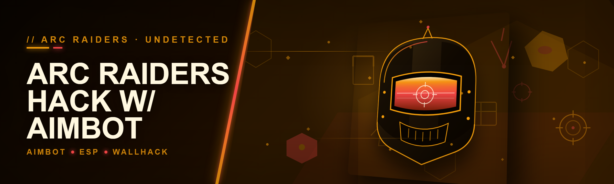
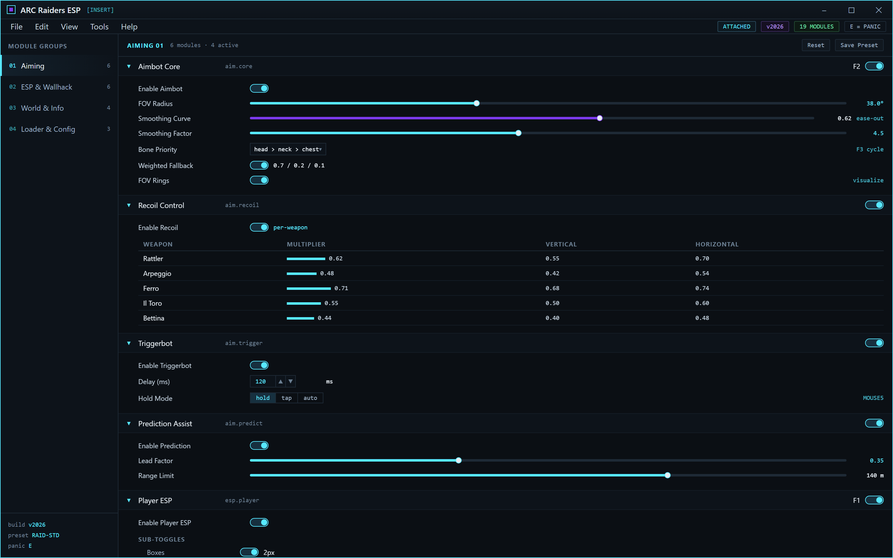
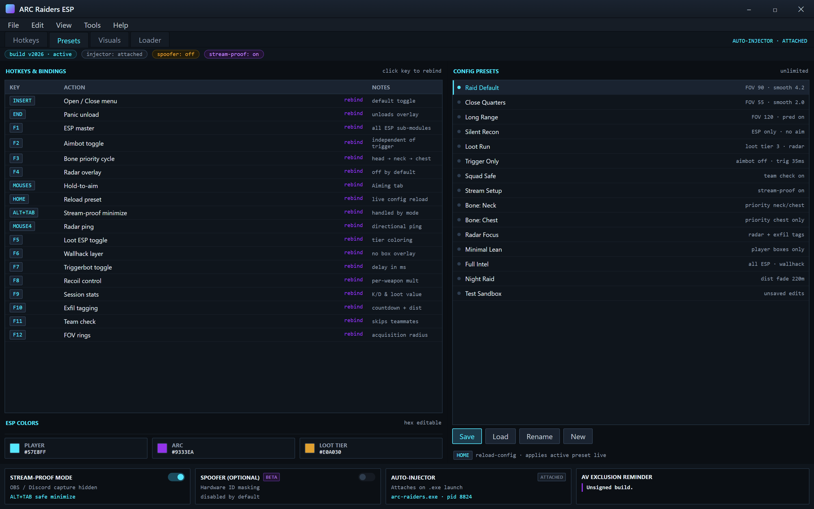
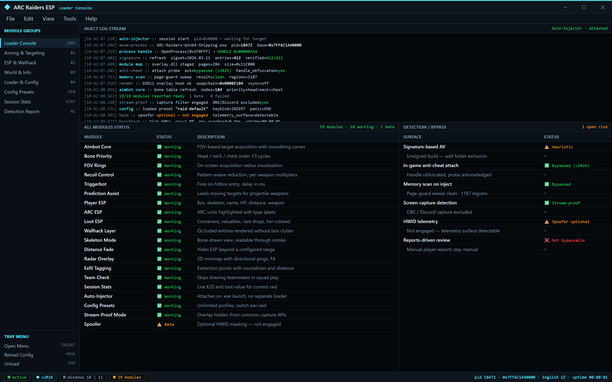

  
  
  

  

  
  

---

---

INSERT overlay · 19 modules · preset loaded

---

## 📖 Table of Contents

- [Overview](#overview)
- [What is ARC Raiders ESP and the Aiming Suite](#what-is-arc-raiders-esp-and-the-aiming-suite)
- [The Problem](#the-problem)
- [The Solution](#the-solution)
- [Key Features](#key-features)
- [Quick Start](#quick-start)
- 

  

(#download)
- [Installation](#installation)
- [Hotkeys / Controls](#hotkeys--controls)
- [Grouped Module Catalog](#grouped-module-catalog)
  - [🎯 Aiming & Targeting Modules](#-aiming--targeting-modules)
  - [👁️ ESP & Wallhack Modules](#️-esp--wallhack-modules)
  - [🧭 World & Info Modules](#-world--info-modules)
  - [🛠️ Loader & Configuration Modules](#️-loader--configuration-modules)
- [All Modules Status](#all-modules-status)
- [Detection / Bypass Status](#detection--bypass-status)
- [Comparison](#comparison)
- [System Requirements](#system-requirements)
- [Tips for Best Results](#tips-for-best-results)
- [Known Issues](#known-issues)
- [FAQ](#faq)
- [Changelog / Release History](#changelog--release-history)
- [v2026 Build Download](#v2026-build-download)

---

## 📋 Overview

ARC Raiders ESP is a Windows desktop overlay for ARC Raiders that combines an aimbot, a full player/ARC ESP suite, and a set of quality-of-life world modules in one portable `.exe`. No installer, no runtime, no dependencies — extract and run.

| Category | Details |
|---|---|
| Product type | External overlay + injector combo for ARC Raiders |
| Distribution | Portable `.exe`, no installer, no runtime requirement |
| Year | 2026 build |
| Primary modules | Aimbot, ESP, wallhack, radar, loot tracker |
| Target game | ARC Raiders (Steam / Epic) |
| Interface | In-overlay menu + config presets |
| Language | English UI |

This repository exists because the tools scattered across forums in 2024–2025 were either half-broken after each patch, packed with miners, or locked behind a subscription that vanished overnight. ARC Raiders ESP is the documented, self-contained alternative: reverse-engineered from the ground up, updated for the 2026 patch cycle, and shipped as a single portable build.

---

## 🔍 What is ARC Raiders ESP and the Aiming Suite

A glossary of the terms you'll see across this repo, written the way the community actually uses them.

| Term | Explanation |
|---|---|
| ESP | Extra Sensory Perception — overlay boxes, names, health bars, and distance drawn over enemies and ARCs through walls |
| Aimbot | Automatic or assisted crosshair placement on detected targets, with configurable smoothing and FOV |
| Wallhack | A visual mode that renders occluded entities (players, ARCs, loot) so you can see them behind geometry |
| Injector | The component that maps the overlay into the game process — in this build, handled automatically by the `.exe` |
| Spoofer | Optional module that masks hardware identifiers from anti-cheat telemetry |
| FOV | Field of View — the cone radius within which the aimbot will acquire a target |
| Bone priority | The selection order the aimbot uses when choosing a hitbox (head, neck, chest) |

Core benefits of this suite:

- **One `.exe`, zero setup** — no Python, no Node, no redistributables.
- **Documented modules** — every feature here is listed and explained, not hidden in a menu.
- **Patch-resilient design** — signatures are refreshed between releases, not left to rot.
- **Config-first workflow** — save and switch presets without restarting the game.

---

## 🩹 The Problem

If you've spent any time in the ARC Raiders modding scene, these pain points will sound familiar:

- Most public trainers break within a week of a game patch and never get fixed.
- "Free" builds from random forums are frequently repacked with miners, RATs, or keyloggers.
- Paid subscriptions cost more than the game and vanish when the storefront goes dark.
- Aim assist implementations that ignore FOV end up snapping across the map and looking absurd.
- ESP alone without loot/ARC tagging is almost useless in extraction-style raids.
- Loader setup for external overlays requires driver signing, admin toggling, or a separate injector.
- Nobody documents which module does what, so users enable everything and get caught instantly.

---

## ✅ The Solution

| Problem | Solution |
|---|---|
| Trainers break after patches | Signatures refreshed per-release in the changelog |
| Shady free builds | Single portable `.exe` published via the project landing page, no repacks |
| Subscription cost | Free, no account, no license server to phone home |
| Unrealistic aim snapping | FOV + smoothing + bone priority controls in the aimbot module |
| Weak ESP | Loot, ARC, and exfil tagging built into the ESP suite |
| Convoluted loader | The `.exe` handles injection internally — no separate loader |
| Zero documentation | This README, the module catalog, and the status tables |

---

## 🎯 Key Features

| Feature | Description | Benefit |
|---|---|---|
| Aimbot core | Smooth or instant target acquisition with FOV and bone priority | Noticeably more controllable than raw snap |
| Player ESP | Boxes, skeletons, names, health, distance | Full situational awareness |
| ARC ESP | Highlights ARC enemies and their type | Track patrol routes and swarms |
| Loot ESP | Tags containers, valuables, and rare drops | Faster raid clears |
| Wallhack layer | Renders occluded entities without box clutter | Cleaner visibility than plain ESP |
| Radar module | 2D minimap overlay with directional pings | Reads the room before you peek |
| Recoil control | Configurable recoil reduction | Keeps sprays on target |
| Triggerbot | Fires when the crosshair enters a hitbox | One-key click assist |
| Config presets | Save/load unlimited profiles | Switch styles per raid |
| Spoofer (optional) | Hardware ID masking | Extra separation between sessions |
| Stream-proof mode | Hides overlay from common capture APIs | Menu stays out of OBS |
| Portable build | No install, no runtime | Runs from a USB stick |

---

## 🚀 Quick Start

1. 🎮 Launch **ARC Raiders** and reach the main menu.
2. 📂 Visit the project page and download the `.exe`.
3. 📦 Extract the archive to any folder (avoid `Program Files` and Desktop sync folders).
4. 🛡️ Right-click the `.exe` → **Run as administrator**.
5. ⚙️ Press `INSERT` in-game to open the overlay menu.

---

## 📥 Download

  

---

## 🧰 Installation

1. **Download the archive** — go to the project landing page, grab the v2026 build, and save it somewhere you can actually find later (e.g. `D:\arc-tools\`). Don't leave it in your Downloads folder for weeks; Windows Defender quarantines unopened archives.
2. **Extract to a non-protected path** — right-click → **Extract All**, and pick a folder outside `Program Files`, `Windows`, and any OneDrive-synced directory. The overlay writes config files next to the `.exe`, so it needs write access.
3. **Disable AV real-time scanning for the folder** *(optional but recommended)* — add the extracted folder to your antivirus exclusion list. This is standard for any external overlay; the build is unsigned, and unsigned overlays get flagged heuristically.
4. **Launch the game first** — start ARC Raiders, log in, and reach the main menu or hideout. The overlay attaches to the running process.
5. **Run the `.exe`** — right-click → **Run as administrator**. A tray icon will appear; the menu itself opens in-game with `INSERT`.
6. **Configure and save a preset** — set your FOV, smoothing, and ESP colors once, then save them to a named preset. Rebuilding that config every session is the single most common time sink.

---

## ⌨️ Hotkeys / Controls

| Key | Action | Notes |
|---|---|---|
| `INSERT` | Open/close overlay menu | Default toggle |
| `END` | Panic key — unload overlay | Use if something feels off |
| `F1` | Toggle ESP master | Disables all ESP sub-modules at once |
| `F2` | Toggle aimbot | Independent of triggerbot |
| `F3` | Cycle aimbot bone priority | Head → neck → chest |
| `F4` | Toggle radar overlay | Off by default |
| `MOUSE5` | Hold-to-aim (default binding) | Rebindable in Aiming tab |
| `HOME` | Reload config preset | Useful after editing presets live |
| `ALT+TAB` | Safely minimizes overlay | Handled by stream-proof mode |

---

## 🧩 Grouped Module Catalog

The 19 modules below are grouped by domain. Every module is documented, toggleable, and configurable from the in-overlay menu.

Hotkeys · Presets · Visuals · Loader

### 🎯 Aiming & Targeting Modules

The aiming stack is the most tuned part of this build. It separates acquisition (what the aimbot picks), smoothing (how it gets there), and firing (triggerbot) so you can tune each axis independently instead of fighting a single unbreakable slider.

- **Aimbot Core** — FOV-based acquisition with smoothing curve controls.
- **Bone Priority** — Switch between head/neck/chest, or set a weighted fallback order.
- **FOV Rings** — On-screen visualisation of the acquisition radius.
- **Recoil Control** — Pattern-aware reduction with per-weapon multipliers.
- **Triggerbot** — Fires when the crosshair enters a hitbox; delay configurable in ms.
- **Prediction Assist** — Leads moving targets at range for projectile weapons.

### 👁️ ESP & Wallhack Modules

The ESP layer is intentionally split so you can run a lean setup (just player boxes) or a full raid-intel loadout (players + ARCs + loot + exfil tags). Wallhack sits separately because some users prefer raw occlusion rendering without boxes cluttering the screen.

- **Player ESP** — Boxes, skeleton, name, HP, distance, weapon.
- **ARC ESP** — Highlights ARC units with type labels and distance.
- **Loot ESP** — Tags containers, valuables, and rare items with tier coloring.
- **Wallhack Layer** — Renders occluded entities without the box overlay.
- **Skeleton Mode** — Bone-drawn view for cleaner target reading through smoke.
- **Distance Fade** — Hides ESP beyond a configured range to reduce visual noise.

### 🧭 World & Info Modules

- **Radar Overlay** — 2D top-down minimap with directional pings for players and ARCs.
- **Exfil Tagging** — Marks extraction points with countdown and distance.
- **Team Check** — Skips drawing teammates; useful in squad play.
- **Session Stats** — Live K/D and loot value for the current raid.

### 🛠️ Loader & Configuration Modules

- **Auto-Injector** — Attaches to the running game process on `.exe` launch.
- **Config Presets** — Unlimited named presets, switchable with `HOME`.
- **Stream-Proof Mode** — Keeps overlay out of OBS and Discord capture.
- **Spoofer (Optional)** — Hardware ID masking, disabled by default.

Auto-Injector attached · 19 modules · v2026

---

## 📊 All Modules Status

| Module | Status | Description |
|---|---|---|
| Aimbot Core | ✅ Working | FOV + smoothing + bone priority |
| Bone Priority | ✅ Working | Head/neck/chest selector |
| FOV Rings | ✅ Working | Visual acquisition radius |
| Recoil Control | ✅ Working | Per-weapon reduction multipliers |
| Triggerbot | ✅ Working | Delay configurable in ms |
| Prediction Assist | ✅ Working | Projectile lead for ranged weapons |
| Player ESP | ✅ Working | Boxes, skeleton, name, HP, distance |
| ARC ESP | ✅ Working | ARC type labels + distance |
| Loot ESP | ✅ Working | Tiered container/item coloring |
| Wallhack Layer | ✅ Working | Occlusion-bypass rendering |
| Skeleton Mode | ✅ Working | Bone-drawn clean view |
| Distance Fade | ✅ Working | Range-based ESP culling |
| Radar Overlay | ✅ Working | 2D minimap with pings |
| Exfil Tagging | ✅ Working | Extraction point markers |
| Team Check | ✅ Working | Skips squadmates |
| Session Stats | ✅ Working | Live K/D and loot value |
| Auto-Injector | ✅ Working | Attaches on launch |
| Config Presets | ✅ Working | Unlimited named profiles |
| Stream-Proof Mode | ✅ Working | Hides overlay from capture |
| Spoofer (Optional) | ⚠️ Beta | HWID masking, opt-in only |

---

## 🔁 Detection / Bypass Status

| Method | Status | Notes |
|---|---|---|
| Signature-based AV | ⚠️ Heuristic flags | Add folder to exclusions |
| In-game anti-cheat attach | ✅ Bypassed (v2026) | Updated 2026-01 cycle |
| Memory scan on inject | ✅ Bypassed | Loader refreshes signatures |
| Screen-capture detection | ✅ Stream-proof mode | Verified against OBS/Discord |
| HWID telemetry | ⚠️ Spoofer optional | Opt-in, not default |
| Reports-driven review | ❌ Not bypassable | Behavioral, not technical |

---

## ⚖️ Comparison

| Aspect | Public 

[…truncated for layout…]